<div align="center">

<a href="https://git.io/typing-svg"></a>
 


</div>

## 🚀 About Me
 
```python
class Akbar:
    role      = "Mechatronics & Embedded Systems Developer"
    teams     = ["Al Cringe (WRO)", "Reckless #25444 (FTC)"]
    focus     = ["autonomous robotics", "computer vision", "mobile systems", "control software"]
    languages = ["Java", "C++", "Python", "Swift"]
    goal      = "B.Sc. in Mechatronics Engineering"
    status    = "building something new right now"
```
 
- 🤖 Lead Programmer & Systems Engineer for **Al Cringe** (WRO) and **Reckless #25444** (FTC)
- 🌍 2x WRO World Finalist and FTC Dubai Finalist Alliance Winner
- 💻 Beyond competitions: computer vision systems, iOS apps, embedded firmware, freelance work

## 🛠️ Tech Stack
 
<div align="center">

</div>
| Domain | What I do |
|---|---|
| ☕ **FTC Java** | Main programmer for Reckless #25444 — FTC SDK, Road Runner, AprilTags / Vuforia |
| ⚡ **Embedded C++** | ESP32 / STM32 / Arduino, dynamic control, multi-sensor integration |
| 👁️ **Computer Vision** | Object detection, tracking pipelines, spatial positioning — OpenCV, YOLO |
| 📱 **Swift / iOS** | Native UI for hardware telemetry and remote monitoring |
| 🧩 **CAD & Prototyping** | Fusion 360 — 3D assemblies, DFMA, 3D printing preparation |
 

## 🏆 Key Achievements
 
| | Event | Result | Team |
|:-:|---|---|---|
| 🇸🇬 | **WRO World Finals — Singapore** | World Finalist, Top 35 globally | Al Cringe |
| 🇵🇷 | **WRO World Finals — Puerto Rico** | National Representative | Al Cringe |
| 🇦🇪 | **FTC Off-Season Dubai** | Finalist Alliance — 2nd place | Reckless #25444 |
| 🇰🇿 | **FTC Almaty Tech Cup 2025** | Top 10 · Lead Programmer | Al-Cringe #25444 |
| 🥇 | **National tournaments** | Multiple-time champion in robotics & hardware design | — |
 
<div align="center">

</div>

## 📊 GitHub Stats
 
<div align="center">


</div>

## 🐍 Contribution Snake
 
<div align="center">
<picture>
  <source media="(prefers-color-scheme: dark)" srcset="https://raw.githubusercontent.com/Klopp-top/Klopp-top/output/github-snake-dark.svg"/>
  <source media="(prefers-color-scheme: light)" srcset="https://raw.githubusercontent.com/Klopp-top/Klopp-top/output/github-snake.svg"/>
  
</picture>
</div>

## 📌 Projects
 
Computer vision, iOS apps, embedded firmware, robotics control — the pinned repos below are just a slice, and new ones keep landing.
 
<div align="center">
<a href="https://github.com/Klopp-top"></a>
<a href="https://github.com/Klopp-top"></a>
 
</div>

## 📫 Connect
 
<div align="center">
<a href="https://github.com/Klopp-top"></a>
 

</div>
 
